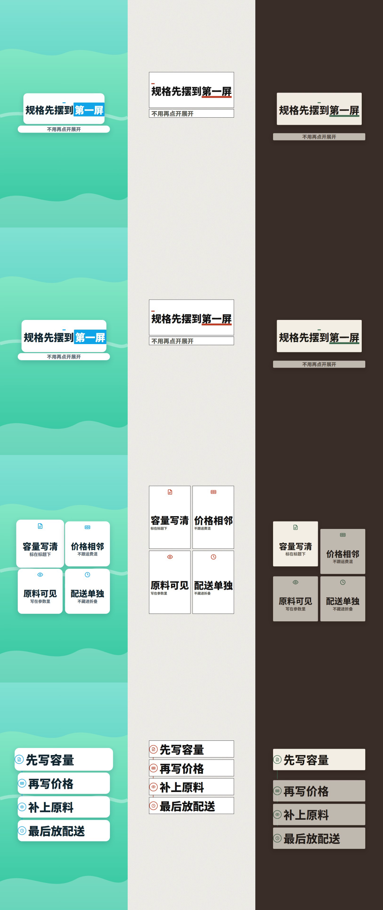

# 场景写法（实验）

模型写语义，引擎算样子。这一屏说什么、强调哪几个字、用哪块版式、哪套风格、哪种动效性格，写在 `scene.json` 里。坐标、字号、出场秒数由引擎按原型、字数和配音时间算出来，再用安全区、字号和对比度检查。

这一版对外标成实验。`quiz` 和 `journey` 不走这条路，继续用原来的分镜。旧的 `storyboard.json`、`lesson.json`、`broll.json` 仍由现在的命令渲染，一行不用改。



## 六类轴

一条画面拆成六类，分开选：

| 轴 | 谁来写 | 写什么 |
|---|---|---|
| 内容单元 | 模型 | 这一屏的角色和文案：主张、条目、对比、截图、数字、片尾 |
| 版式原型 | 模型写名字，引擎排 | `hero`、`stack`、`grid`、`split`、`sequence`、`media`、`chart`、`end`、`board` |
| 风格 | 模型写名字 | 颜色、圆角、字重、质感。见下面「风格」 |
| 动效 | 模型写性格名 | `crisp`、`bounce`、`soft`、`paper`、`push` |
| 时间 | 引擎 | 有逐字配音走字的开始时间，没配音按拍。两种来源不混在同一屏 |
| 硬约束 | 引擎 | 安全区、字号下限、对比度不低于 4.5、第 0 帧已经有主文案 |

不要写坐标、像素、帧号、毫秒。`when` 是旁白里连续的几个字，不是秒。

## 版式原型

| 名字 | 适合 |
|---|---|
| `hero` | 一句主张，或一个大数字 |
| `stack` | 条目上下排 |
| `grid` | 最多 4 条，格子 |
| `split` | 左右对比 |
| `sequence` | 有先后的几步 |
| `media` | 一张图加标注。截图板用 `board` |
| `chart` | 至少两个能对上事实原文的数 |
| `board` | 资讯板：栏目标、判断句、证据或大数字 |
| `end` | 片尾：品牌和一句口号 |

内容种类和版式不是任意搭配。截图用 `role: "media"`、`layout: "board"`。大数字用 `role: "number"`，`text` 是数字加单位，最多 6 个字，而且必须是所引事实原文里连续的那一段。

## 风格

示例里用到的六套：

| 名字 | 产品 | 样子 |
|---|---|---|
| `fresh-light` | `promo` | A。渐变底，圆角卡片 |
| `editorial` | `lesson` | B。杂志。零圆角，重字重 |
| `techbrief` | `promo` | 资讯板。判断句直接写在舞台上，证据和条目仍是卡片。配 `push` |
| `cutpaper-collage` | `promo` | 整支剪纸拼贴。一块色卡在几处场景之间换形接力，不靠淡化。配 `crisp`。适合一件东西走完整支片（一张票、旧衣服、一处地方）。不适合教程、仪表盘、数据对照、真人出镜、一句接一句的说明 |
| `impressionist` | `promo` | 印象派水面。满屏短笔触、垂枝、拱桥、睡莲和光斑一直在缓动。字落在水面较平的一段，后面只有一小片融开的雾。配 `soft`。适合文化、艺术、节日、情绪。不适合数据密集的讲解 |
| `mural` | `promo` | 古代壁画。横带分格都画满，芦苇、飞鸟、日轮、侧身人物和纹样一直在缓动。字写在只包住字行的题记横带上。配 `soft`。适合文化、艺术、节日、情绪。不适合数据密集的讲解 |

宣传片还可以用 `template/src/core/themes.json` 里的主题名，另加 `techbrief`、`cutpaper-collage`、`impressionist`、`mural`。讲课可以用 `template/src/lesson/style-tokens.json` 里的名字，示例用 `editorial`。

`editorial` 不要配 `bounce`。宣传片风格不要配 `paper`。`paper` 是口播纸片的性格。

`cutpaper-collage` 的可选字段是 `relay`：`card`、`patch`、`guide`、`tumble`、`postcard`、`window`。不写就按版式推导。模型仍不写坐标和秒数。某一屏写了 `src` 时，图会裁进衣身；不写就用一块纯色剪影。

## 动效性格

`crisp` 干净，`bounce` 回弹，`soft` 缓，`paper` 纸片，`push` 从下方推进。性格只决定入场曲线和提前量，不决定文案。

## 命令

从已经写好的 `scene.json` 出片：

```
node scripts/scene/make-scene.mjs <scene.json> --out <仓库外目录> [--style 名字] [--motion 性格] [--voice-provider minimax|aliyun|volcengine|mock] [--no-voice] [--no-bgm]
```

从旧分镜转成 scene.json：

```
node scripts/scene/from-legacy.mjs <storyboard.json|lesson.json> --out <scene.json> [--skip-unsupported]
```

从简报到成片（先写场景，再出片）：

```
node scripts/scene/brief-to-video.mjs <brief.md|json> --out <仓库外目录> [--assets <素材清单.json>]
```

有旁白时要写 `--voice-provider`，或写 `--no-voice`。没写这两项，命令会停下来。没有这家密钥时，用 `--voice-provider mock` 看节奏。mock 不联网、不计费，是占位音，不能当交付。密钥只从环境变量读，不会打印，也不要写进文件。

配音按每一屏的 `narration` 合成，拿到逐字时间后再算这一屏多长。字幕固定在底部字幕带（9:16 下沿 y=1340，不进平台底栏，也不挪到顶部），逐字点亮，不铺底板。已经写在屏上的标题、判断句、数字和条目会从字幕里去掉，整句都重复时这一屏不出字幕。配乐复用现有脚本，人声处压低。检查没过时，成片改名为 `video.rejected.mp4`。

没有 DeepSeek 密钥时，一条龙会直接说明，并提示改跑 `make-scene.mjs`。

一句话改稿：

```
node scripts/revise.mjs <scene.json> "一句话"
```

能改屏上的文案、强调、版式名、风格名、性格名、疏密、剪纸拼贴的接力名。不能改素材路径、事实原文、角色、画幅，也不能写坐标。改完会再跑校验和几何审计。

给便宜模型写场景的提示词，用 `scripts/scene/deepseek-layouts.mjs` 里导出的 `prompt`，不要另写一份。

可直接出片的示例：`examples/scene/a-fresh.json`、`examples/scene/b-editorial.json`、`examples/scene/c-techbrief.json`、`examples/scene/d-cutpaper.json`、`examples/scene/e-impressionist.json`、`examples/scene/f-mural.json`。横版宣传是 `examples/scene/wide-promo.json`，带讲解员的横版讲课是 `examples/scene/lesson-presenter.json`，口播里用一屏场景画面的是 `examples/scene/talk-scene-broll.json`。

## 和旧写法的关系

旧分镜仍然是宣传片的正式写法。`scene.json` 是同一条宣传片里的实验入口，不另占分流表的一行。出片命令不同：旧的走 `scripts/make.mjs`，新的走 `scripts/scene/make-scene.mjs`。

## 从旧分镜迁移

原则：旧分镜始终能渲染。这一轮只做加法，不删旧组件，不改 `SHOT_TYPES`、`lessonLayouts` 的键，也不改口播五个模板名。

预设表在 `template/src/scene/presets.json`。每一行是旧名、内容种类、版式原型（九种之一，或「不可展开」）、默认风格来源、默认性格、退场，以及和旧组件的行为差异。覆盖宣传片 19 个镜头、讲课 20 个版式、口播 5 个模板，外加 `quiz`、`journey` 两行「不可展开」。以后新增镜头忘了登记，`node tests/scene/run.mjs` 会失败。

把旧分镜转成 scene.json：

```
node scripts/scene/from-legacy.mjs <storyboard.json|lesson.json> --out <scene.json>
```

遇到不能转的镜头，命令停下并列出是哪几个。加 `--skip-unsupported` 才跳过。原文案、事实、素材路径原样带过去。

这一轮能转的：宣传片 `features`、`steps`、`quickList`、`compare`、`counter`、纯文字的 `hook`（`visual=icon`）、`endCard`；讲课 `steps`、`points`、`compare`、`bignumber`。转出来的文件要再跑 `validateScene` 和几何审计，出片仍用 `make-scene.mjs`。

现在转出来的片子比旧组件素：聚光逐张弹出、步骤光点打勾、盖章和价格角标、VS 徽章和结论胶囊、片尾卖点胶囊都还没有。转换器用来试新写法；旧分镜照旧用 `scripts/make.mjs` 出片，效果更好。

还没迁、继续走旧组件的：`quiz`、`journey`（整片流程，不可展开）；`chat`、`phone`、`mockApp`、`dataChart`、`meter`、`photoShot`（媒体框、图表、仪表不是这一轮原型能画的）；以及 `priceCard`、`factSheet`、`credCard` 等设计第 6 步以后再迁的镜头。口播五个模板也仍走旧组件。旧 `counter` 会算降幅，新引擎默认不算。

## 横版、讲课和口播

`aspect` 可以写 `9:16` 或 `16:9`。不写时，宣传片和口播是 `9:16`，`product: "lesson"` 是 `16:9`。`4:5` 仍拒绝出片。

横版画面是 1920×1080。版式探针按成片真实宽度换算，不再把坐标折成 1080 宽，所以安全区、相交和裁切检查用的是 1920×1080 上的像素。内容区沿用讲课横版：x 120–1800、y 300–880。右下 x≥1600 且 y≥810 留给讲解员，排版时这一角收到 x 1580。字幕用讲课的字幕条：x 260–1540、y 900–1016，在内容框下面，也不压到讲解员圆窗（圆窗从 x 1614 起）。宣传片自己的 `aspects.json` 没有 16:9，所以横版安全区和字幕都沿用讲课这套，不另裁一圈。

横版几何：`split` 左右各一组；`grid` 两条两列，三条是上一下二，四条 2×2；`media` 图占内容宽的 62%，字在右侧；`board` 仍是上栏目标、下证据，多出来的高度给证据。字号下限不另做：宣传片仍是正文 40，讲课横版正文 44、标题 64。

`product: "lesson"` 之后，`style` 用讲课主题名（`paper`、`lecture`、`product`、`editorial`）。`presenter.kind` 可以是 `cartoon`、`real`、`video` 或 `none`，沿用讲课引擎的讲解员，不另画一个人。有卡通或真人时，版式让开右下角。片头 90 帧内出「AI生成合成」，和讲课一样，不是常驻角标。`domain` 写成 `legal` 才在片尾出「普法内容，不构成法律意见」。

口播要在某一段用场景画面时，`broll.json` 的该段写 `"template": "scene"`。`slots.title` 和 `slots.items` 仍是原句里的字。画面用这段口播的配色，画在 B-roll 取景框里。原来的 `keyword`、`checklist`、`steps`、`counter`、`compare` 不变。

对比屏（`role: "compare"`、`layout: "split"`，并写了 `left` / `right`）竖版也分成上下两组：每组有组标签，中间有分隔。横版则是左右两组。

## 已知限制

- 实验功能。校验和几何过了，也不等于可以当正式交付标准。
- `quiz`、`journey` 不拆进这套场景。
- 没配音的屏按拍计时。配了音的屏只用逐字时间。同一屏不会把两种来源混在一个时间对象里。
- 逐字字幕固定在字幕带里。竖版下沿 y=1340。横版用上面的讲课字幕条。和标题、kicker、证据、数字、条目相交就算检查失败，不会改放到画面顶部。
- 口播里的 `scene` 段这一版收成标题加条目的一屏，不把整份 `scene.json` 嵌进去。真人讲解员要本地 mp4，示例用卡通。
- 旧的 `lesson.json` 和原来的五段口播模板不读这些新字段。
